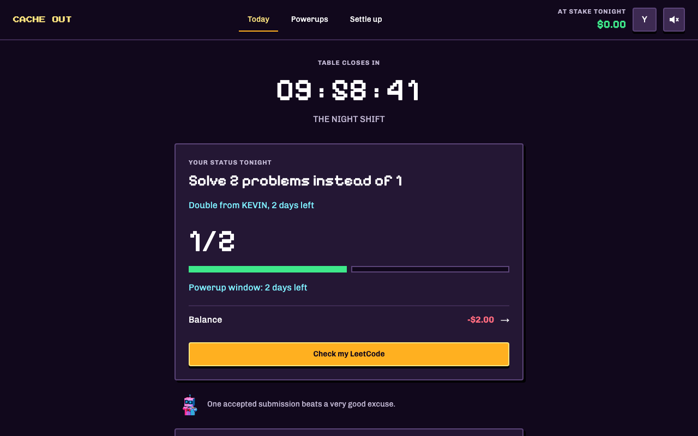

# CACHE OUT

A daily LeetCode table for friends. Solve your problem, post a photo, and see what everyone else got done. Miss a day and you owe the people who cleared. There's a pixel casino, a nosy dealer, and powerups for making your friends work a little harder.



## Features

- Server-verified LeetCode submissions
- Proof photos, reactions, and comments
- Double, Hard mode, and Daily powerups
- Balances, Venmo links, and confirmed payments
- Invite links and optional Discord reminders
- Local demo with a seeded friend group

## Rules

Solve one problem each day; miss it and owe $1 to each player who cleared.
Powerups give you 2–3 days; miss their deadline and owe $2 to each player who cleared.
Post your proof to reveal the crew's photos. Debts stay until payment is confirmed.

## Stack

React 19, TypeScript, Vite, Tailwind v4, zustand, and Supabase. The pixel assets come from a small CPU ray tracer in `tools/pixeltracer`.

## Local dev

Use Node 22 or newer.

```sh
npm install
npm run dev
```

Without `.env.local`, the app runs a local demo. To use Supabase, copy `.env.example` to `.env.local` and fill in the three values.

## Deploy

1. Create a Supabase project.
2. Run `npx supabase link --project-ref <ref>` and `npx supabase db push`.
3. Set `SWEEP_SECRET` with `npx supabase secrets set SWEEP_SECRET=<random-secret>`; optionally set `ALLOWED_ORIGIN`.
4. Run `npx supabase functions deploy leetcode` and `npx supabase functions deploy sweep`.
5. Create the `sweep_url` and `sweep_secret` Vault secrets using the SQL in [backend setup](supabase/README.md).
6. Set Auth Site URL and the redirect allowlist to your site.
7. Configure custom SMTP, for example with Resend.
8. Import the repository into Vercel and set `VITE_SUPABASE_URL`, `VITE_SUPABASE_ANON_KEY`, and `VITE_SITE_URL`.
9. Add your domain in Vercel and update the Auth URLs.

## Scripts

- `npm run verify` — types, lint, shared rules, app tests, and renderer tests
- `npm run check:functions` — Deno Edge Function checks
- `npm run build` — production build; requires Supabase configuration
- `CACHE_OUT_ALLOW_DEMO_BUILD=1 npm run build` — demo production build
- `npm run sync:shared` — copy domain modules into Edge Functions
- `npm run assets` — render sprites and the CSS palette
- `npm run backdrops` — render animated landing backgrounds
- `npm run trace:verify` — check the pixel renderer
