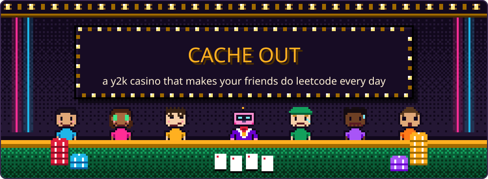
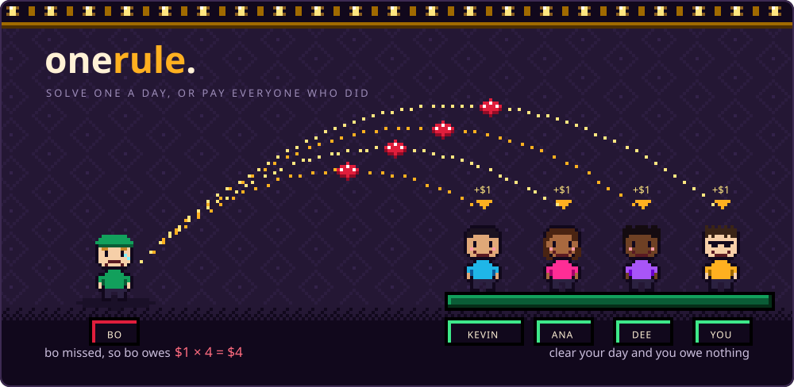
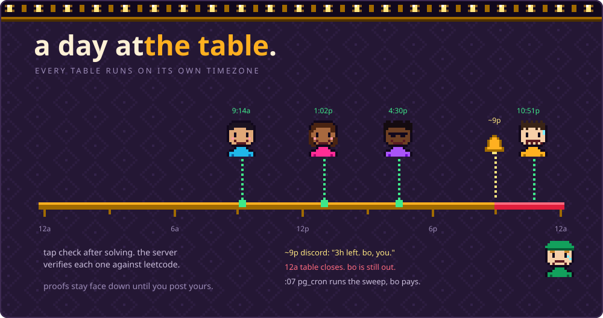
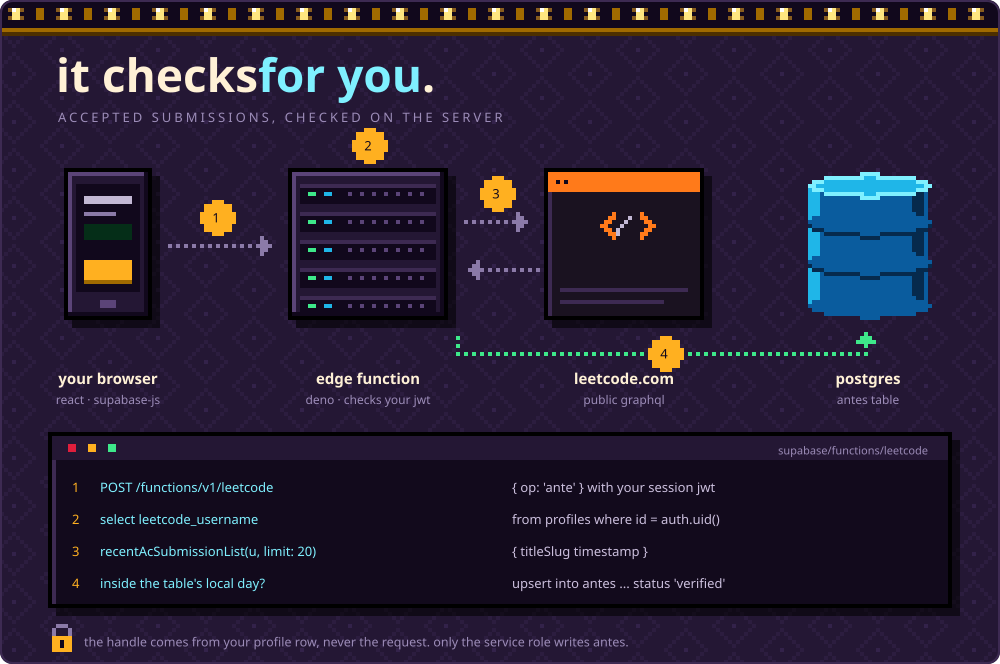
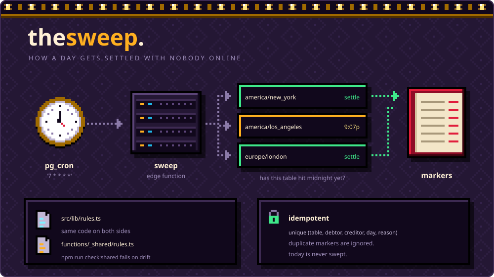
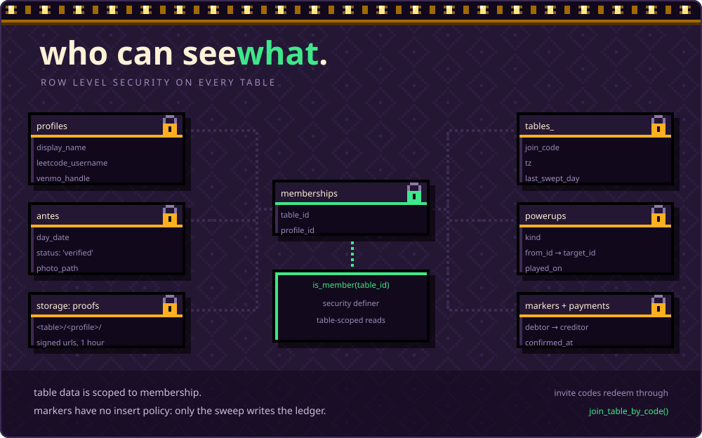
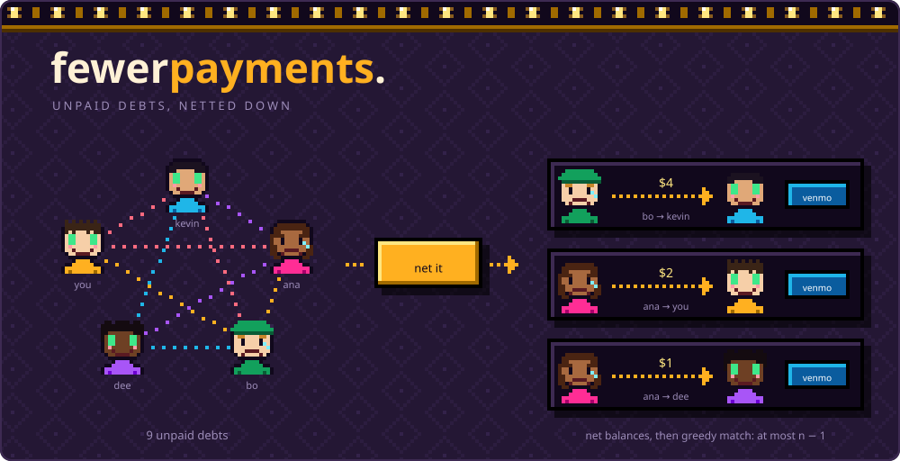
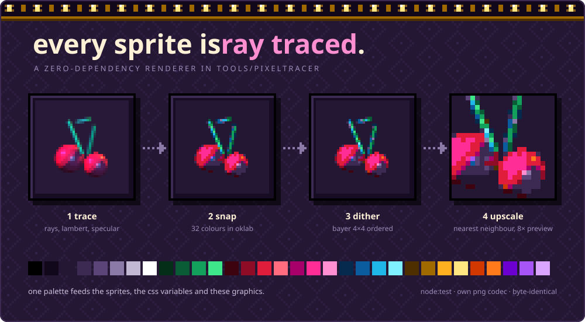
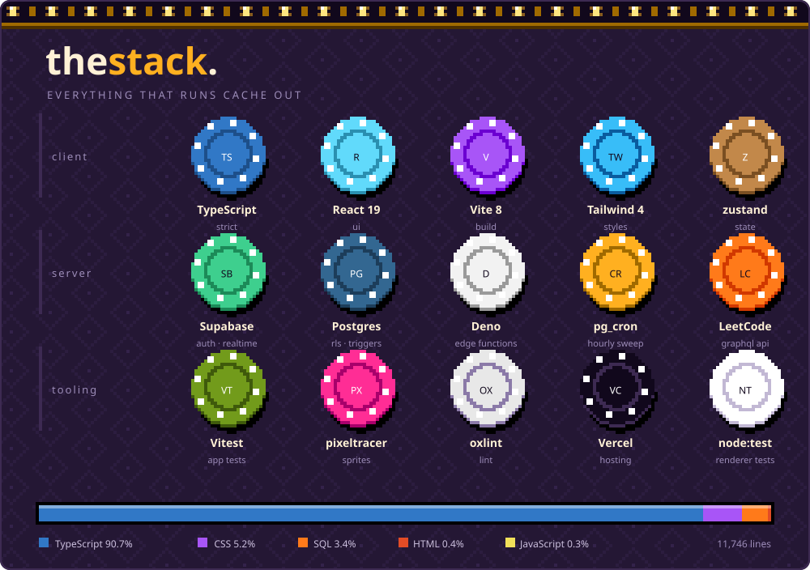

CACHE OUT is a daily LeetCode table for a group of friends who need a reason to keep going.
Miss a day and you owe the people who cleared it; the casino is where you keep score.
A server checks accepted submissions, so the browser cannot just declare a day solved.


The local demo opens with a seeded friend group and an unfinished day.

## The rule



On an ordinary day, solve one problem before the table's midnight.
If Bo misses while Kevin, Ana, Dee, and you clear, he owes each of you $1, or $4 total.
The money is recorded as individual debts; if nobody clears, there is nobody to pay.

Powerups change the requirement for a short window: Double asks for two problems over
three days, Hard mode asks for a Hard over three days, and The Daily gives two days
for the official Daily. An unmet window costs $2 per player who clears when it closes,
with no charge while time remains. Live powerups cannot stack on the same person.

## A day at the table



Each table has its own timezone, so everyone shares a deadline even when they travel.
After solving, tap Check my LeetCode, then attach a photo and caption.
The interface keeps your friends' proofs face down until you post yours, like BeReal.
That reveal is a social rule in the UI; table members can still fetch the underlying photos.

If the table has a Discord webhook, the hourly job sends a warning when more than two
and at most three hours remain, roughly 9pm. Midnight ends the day, and the next successful
sweep records the debts. The illustrated :07 settlement assumes a whole-hour UTC offset;
the cron schedule itself runs at minute seven in UTC.

## How it works

The client shows progress; Edge Functions verify submissions and settle finished days.
Postgres stores the results and decides which rows a signed-in player can access.

### Verification



LeetCode's GraphQL endpoint does not provide the CORS access a browser client needs,
and a browser's claim that someone solved a problem is not evidence.
The `leetcode` function validates the session JWT and reads the handle from that user's
profile row, rather than accepting a different handle with each verification request.

It asks `recentAcSubmissionList` for the latest 20 accepted submissions and keeps the
ones whose timestamps fall inside the table's current local day. It also fetches problem
difficulty and the official Daily so powerups can use the same verified records.
Only the service role writes `antes`, including attaching a photo to an existing verified solve.

### The sweep



A single daily job would close some tables too early and others too late.
Instead, `pg_cron` runs `7 * * * *`; the `sweep` function checks each table's local date
and processes completed days after its saved watermark. Today is never swept.

Each marker is unique on `(table_id, debtor_id, creditor_id, day_date, reason)`.
Inserts ignore conflicts, so retrying a day does not duplicate those debts.
The browser and sweep use copies of the same pure rules, and `npm run check:shared`
fails if `src/lib` and `supabase/functions/_shared` drift apart.

### Who can see what



Table data is protected by row-level security tied to membership.
The `is_member(table_id)` helper is `security definer` so checking membership does not
re-enter the membership table's own policy. Profiles also allow you to read your own row,
and other members of your tables can read your profile.

Proofs live in a private bucket under `<table>/<profile>/` and load through signed URLs
that last one hour. Those URLs can be used by anyone who has them until they expire.
Invite codes are redeemed through `join_table_by_code()`; a separate preview function
reveals the table name for a valid code before joining.

### Settling up



Debts carry forward until payments offset them, rather than resetting every week.
Netting combines each person's balance, then greedily matches debtors to creditors.
For n people with nonzero balances, that takes at most n − 1 payments, although it does
not always find the smallest possible number. The example reduces nine debts to three.

A Venmo deep link fills in the recipient and amount so you can make the payment outside
the app. Recording it creates a pending payment; the recipient must confirm receipt
before it changes either balance. The app does not move money or verify Venmo transactions.

### The art



The app's sprites come from a zero-dependency CPU ray tracer in `tools/pixeltracer`,
running on Node's native TypeScript support. It quantizes in OKLab against 32 colors,
uses a Bayer 4×4 dither, and enlarges pixels without smoothing.
The panel shows an 8× preview; the app's sprite sheets are generated at 4×.

`npm run assets` regenerates sprites and CSS palette variables from that shared palette.
`npm run readme` draws these panels with a separate pixel illustration kit, adding skin
and text colors around the same base palette. The panels embed their fonts and artwork
inside each SVG, so they do not need a font server to render.

## Stack



- **Client:** TypeScript, React 19, and zustand handle UI and state; Vite 8 builds it,
  and Tailwind 4 supplies styles.
- **Server:** Supabase provides Auth, Postgres, Storage, and Realtime; Deno Edge Functions
  query LeetCode and handle the sweep scheduled by `pg_cron`.
- **Tooling:** Vitest covers the app, `node:test` covers the renderer, oxlint checks source,
  and Vercel hosts the frontend. The panel's language bar counts source lines, not bytes.

## Limitations

- LeetCode's GraphQL API is public but unofficial, and its responses can change.
- Verification needs accepted submissions to be visible through that API. Only the latest
  20 are fetched, so older solves can fall out of the window before you check them.
- A stored LeetCode handle is not proof of account ownership. The seven-day handle lock
  and verification limits discourage gaming; they cannot establish who wrote a solution.
- Proofs being face down is a UI convention, not an access restriction between table members.
- Venmo payments are confirmed by people, so the ledger still depends on honest reporting.
- Discord notifications are claimed before sending. A crash between those steps can lose
  a message, even though the claim prevents duplicate sends from concurrent runs.

## Run it locally

Use a Node version with native TypeScript enabled, such as Node 24.
Install dependencies and start the development server:

```sh
npm install
npm run dev
```

Without `.env.local`, the app runs a local demo with no Supabase account needed.
For the real backend, copy `.env.example` to `.env.local` and fill in its three values.

## Deploy

1. Create a Supabase project, then link it and apply the migrations with the commands in
   [backend setup](supabase/README.md), including the server-only ante policy.
2. Set `SWEEP_SECRET`, deploy both Edge Functions, and create the `sweep_url` and
   `sweep_secret` Vault secrets using that guide. Set `ALLOWED_ORIGIN` if needed.
3. Set the Auth Site URL and redirect allowlist, and configure custom SMTP.
4. Import the repository into Vercel with `VITE_SUPABASE_URL`, `VITE_SUPABASE_ANON_KEY`,
   and `VITE_SITE_URL`. Add your domain and update the Auth URLs to match.

The backend guide includes the exact CLI commands and Vault SQL.
A production build requires Supabase configuration; demo builds require an explicit flag.

## Scripts

- `npm run verify`: types, lint, shared rules, app tests, and renderer checks.
- `npm run check:functions`: Deno checks for both Edge Functions.
- `npm run build`: production frontend build.
- `CACHE_OUT_ALLOW_DEMO_BUILD=1 npm run build`: demo production build.
- `npm run sync:shared`: copy domain modules into Edge Functions.
- `npm run check:shared`: check those copies without changing them.
- `npm run assets`: render sprites and the CSS palette.
- `npm run backdrops`: render animated landing backgrounds.
- `npm run trace:verify`: check the pixel renderer.
- `npm run readme`: regenerate the nine illustrated README panels.
